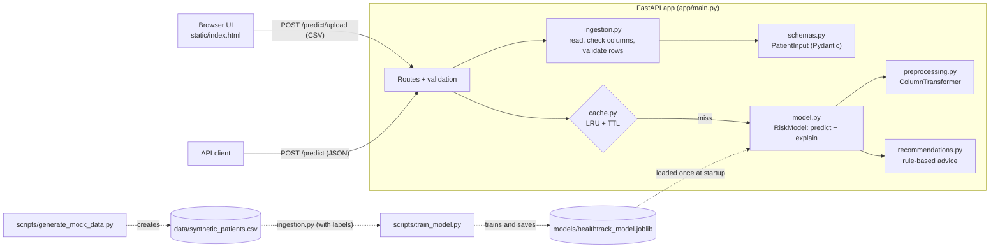

# HealthTrack: AI-Powered Patient Health Insights

> **Important:** HealthTrack is an educational demonstration. All patient data and all risk labels are
> **synthetic** (generated by a script). They do not represent real clinical outcomes, and the model is
> **not** clinically validated. It does not provide medical advice, diagnosis, or treatment.

## 1. Project Overview

HealthTrack helps a health coach get quick, explainable insights from patient health data. The coach
uploads a CSV file of patients, and for every valid patient the app returns:

- a predicted risk level: **Low**, **Medium** or **High Risk**
- the probability of each risk level
- the **top three factors** that contributed most to the prediction
- **personalised recommendations** based on the risk level, those factors, and the patient's own values

The project was built for an AI Engineer take-home assignment, to show a complete, end-to-end ML
feature: data ingestion and validation, a trained model, an API, explainability, a simple UI, tests,
logging, and caching.

### How each requirement is met

| Requirement | Where | How to check it |
|---|---|---|
| **Must:** data ingestion accepts a CSV and outputs a cleaned dataset | `app/ingestion.py` | `python -m app.ingestion data/sample_patients.csv` writes `data/sample_patients_cleaned.csv` and lists the rejected rows |
| **Must:** classification model with at least 75% validation accuracy | `app/model.py`, `scripts/train_model.py` | `python -m scripts.train_model` reports **88.5%** validation accuracy (5-fold CV: 84.4% ± 1.9%). `tests/test_model.py` checks the 75% target on three random datasets. |
| **Must:** API returns JSON risk predictions and recommendations | `app/main.py` (`POST /predict`, `POST /predict/upload`) | See [API documentation](#6-api-documentation) or <http://127.0.0.1:8000/docs> |
| **Must:** README with architecture, design decisions and trade-offs | This file | [Architecture](#2-architecture), [Design decisions and trade-offs](#8-design-decisions-and-trade-offs) |
| **Should:** UI to upload a CSV and view predictions and recommendations | `app/static/index.html` | Open <http://127.0.0.1:8000> and upload `data/sample_patients.csv` |
| **Should:** logging and error handling; an invalid CSV is logged and the error returned to the user | `app/logging_config.py`, `app/main.py`, `app/ingestion.py` | Upload a non-CSV file: the UI shows the error and `logs/healthtrack.log` records it |
| **Could:** caching makes repeated queries faster | `app/cache.py` | Submit the same data twice: `cached: true` appears and `processing_time_ms` drops (see [measured timings](#accuracy-vs-speed)) |

**Main features**

- CSV ingestion with per-row validation: invalid rows are reported with their row number and reason, and
  valid rows are still processed. The module can also be run on its own to produce a cleaned dataset.
- Multiclass Logistic Regression in a scikit-learn `Pipeline` (imputation, scaling, one-hot encoding)
- Per-patient feature contributions calculated from the model's coefficients
- Rule-based recommendations that are easy to read and extend
- FastAPI backend with JSON and CSV endpoints and consistent error responses
- In-memory LRU cache with a time-to-live (TTL)
- Console logging plus a rotating log file; patient health values are never logged
- Single-page HTML/CSS/JavaScript frontend
- 70 automated tests (pytest)

## 2. Architecture



**How a request flows**

1. The coach picks a CSV in the browser. JavaScript sends it to `POST /predict/upload` using `fetch` and
   `FormData`.
2. FastAPI checks the file type and size (max 2 MB). Then `ingestion.py` reads the CSV with pandas,
   checks that all required columns exist, and validates every row with the `PatientInput` Pydantic
   model.
3. Invalid rows become `row_errors`. Valid patients go to `run_predictions()` in `main.py`.
4. For each patient, a cache key is built from the normalised features and the model version. Cache hits
   are returned immediately, and all misses go to the model together in one batch.
5. `RiskModel.predict()` runs the saved pipeline (preprocessing + Logistic Regression). It returns the
   probabilities and works out the top three contributing factors.
6. `generate_recommendations()` builds advice from the risk level, the top factors and the patient's values.
7. The response goes back to the browser. It contains the predictions, row errors, processing time and
   disclaimer. The browser renders a table with colour-coded badges and expandable details.

**Two separate workflows**

- **Offline (training):** `generate_mock_data.py` creates the dataset. `train_model.py` loads it through
  the same ingestion module, with the labels validated too. It then trains, evaluates and saves the model
  along with `models/metrics.json`.
- **Online (serving):** the API loads the saved model **once at startup** and never retrains per request.

## 3. Tech Stack

| Technology | Purpose |
|---|---|
| Python 3.11+ | Main language (developed and tested on Python 3.13) |
| FastAPI | Web API framework: routing, automatic request validation, built-in docs at `/docs` |
| Pydantic | Defines and validates patient data (types, ranges, allowed categories) |
| pandas | Reads CSV files and handles tabular data |
| scikit-learn | Preprocessing (`SimpleImputer`, `StandardScaler`, `OneHotEncoder`, `ColumnTransformer`), `LogisticRegression`, metrics, cross-validation |
| joblib | Saves and loads the trained model pipeline |
| uvicorn | ASGI server that runs the FastAPI app |
| python-multipart | Lets FastAPI accept file uploads |
| python-dotenv | Loads optional settings from a local `.env` file |
| pytest + httpx2 | Automated tests; FastAPI's `TestClient` uses httpx2 to call the app in memory |
| HTML, CSS, vanilla JavaScript | The single-page frontend, with no framework and no build step |

## 4. Project Structure

```
healthtrack/
├── app/
│   ├── main.py              # FastAPI app, routes, startup, error handlers, run_predictions()
│   ├── config.py            # Settings from environment variables / .env
│   ├── schemas.py           # Pydantic models: PatientInput (validation) and response formats
│   ├── ingestion.py         # CSV reading, column checks, per-row validation, cleaned dataset, CLI
│   ├── preprocessing.py     # Feature lists, ColumnTransformer, prepare_features()
│   ├── model.py             # Train, evaluate, save/load, RiskModel (predict + explain)
│   ├── recommendations.py   # Disclaimer, risk-level guidance, factor rules
│   ├── cache.py             # PredictionCache: in-memory LRU cache with TTL
│   ├── logging_config.py    # Console + rotating file logging
│   └── static/index.html    # Single-page frontend
├── scripts/
│   ├── generate_mock_data.py  # Creates the synthetic dataset and the demo upload file
│   └── train_model.py         # Trains, evaluates, saves the model and metrics
├── data/
│   ├── synthetic_patients.csv # 1,000 labelled synthetic patients (training data)
│   └── sample_patients.csv    # 18-row demo upload, including 6 deliberately invalid rows
├── models/
│   ├── healthtrack_model.joblib  # Trained pipeline (~6 KB, committed so the app runs immediately)
│   └── metrics.json              # Evaluation results from the last training run
├── logs/                    # Created at runtime; ignored by Git
├── tests/                   # pytest test suite
├── requirements.txt
├── pytest.ini
├── .env.example
└── .gitignore
```

## 5. Setup and Installation

The commands below are for **Windows PowerShell**. Where macOS/Linux differ, the equivalent is shown.
Run everything from the `healthtrack` folder.

```powershell
# 1. Create a virtual environment
python -m venv .venv

# 2. Activate it
.venv\Scripts\Activate.ps1          # macOS/Linux: source .venv/bin/activate
# If PowerShell blocks the script, run once:
#   Set-ExecutionPolicy -Scope CurrentUser RemoteSigned

# 3. Install dependencies
pip install -r requirements.txt

# 4. (Optional) copy the example settings; every setting has a default
copy .env.example .env               # macOS/Linux: cp .env.example .env

# 5. Generate the synthetic data (reproducible: fixed random seed)
python -m scripts.generate_mock_data

# 6. Clean a CSV with the ingestion module (writes data/sample_patients_cleaned.csv)
python -m app.ingestion data/sample_patients.csv

# 7. Train and evaluate the model (saves models/healthtrack_model.joblib and models/metrics.json)
python -m scripts.train_model

# 8. Start the API server
uvicorn app.main:app --reload
```

Steps 5–7 are optional, because the generated data and the trained model are already committed. Run
them to reproduce or regenerate those files.

- **UI:** open <http://127.0.0.1:8000> and upload `data/sample_patients.csv`
- **Interactive API docs:** <http://127.0.0.1:8000/docs>

**Run the tests**

```powershell
pytest
```

## 6. API Documentation

All prediction responses have the same format and always include the medical disclaimer. Errors always
include a `detail` message.

### `GET /health`

```bash
curl http://127.0.0.1:8000/health
```

```json
{"status": "ok", "model_loaded": true, "model_version": "1.0.0"}
```

If the model file is missing, the server still starts and `/health` reports `"model_loaded": false`.
The prediction endpoints then return **503** with instructions to train the model.

### `POST /predict` (JSON)

Accepts 1 to 1,000 patients. Health fields can be left out or set to `null`; the model's imputer then
fills them in.

```bash
curl -X POST http://127.0.0.1:8000/predict \
  -H "Content-Type: application/json" \
  -d '{"patients": [{"patient_id": "P100", "age": 58, "sex": "male", "bmi": 32.1,
       "systolic_bp": 145, "diastolic_bp": 92, "resting_hr": 80, "glucose": 130,
       "cholesterol": 250, "smoker": "current", "alcohol_units_week": 10,
       "exercise_days_week": 1, "sleep_hours": 6, "family_history": "yes"}]}'
```

On Windows PowerShell, use `curl.exe` and save the JSON to a file (`-d "@patient.json"`). Alternatively,
try the endpoint from <http://127.0.0.1:8000/docs>.

Response (recommendations shortened):

```json
{
  "model_version": "1.0.0",
  "total_rows": 1,
  "processing_time_ms": 23.43,
  "predictions": [
    {
      "patient_id": "P100",
      "risk_level": "high",
      "risk_label": "High Risk",
      "probabilities": {"low": 0.0, "medium": 0.0001, "high": 0.9999},
      "top_factors": [
        {"feature": "glucose", "value": 130.0, "contribution": 1.9658, "direction": "increases"},
        {"feature": "bmi", "value": 32.1, "contribution": 1.6542, "direction": "increases"},
        {"feature": "systolic_bp", "value": 145.0, "contribution": 1.4713, "direction": "increases"}
      ],
      "recommendations": [
        "Encourage the patient to arrange a review with a qualified healthcare professional soon.",
        "Agree on a structured plan with regular follow-ups to track progress.",
        "Encourage appropriate physical activity and healthy, balanced nutrition.",
        "Blood pressure is elevated: recommend discussing blood pressure monitoring with a qualified healthcare professional.",
        "Suggest seeking professional smoking cessation support."
      ],
      "cached": false
    }
  ],
  "row_errors": [],
  "disclaimer": "This application is an educational demonstration and does not provide medical advice, diagnosis, or treatment. Consult a qualified healthcare professional for medical decisions."
}
```

Sending the same request again returns `"cached": true` and a much lower `processing_time_ms` (exact
times vary from machine to machine).

Validation error (**422**). The submitted values are not echoed back:

```json
{"detail": "Invalid request data.",
 "errors": [{"location": "body.patients.0.age", "message": "Input should be less than or equal to 110"}]}
```

### `POST /predict/upload` (CSV)

```bash
curl -F "file=@data/sample_patients.csv;type=text/csv" http://127.0.0.1:8000/predict/upload
```

The response has the same format as `/predict`. With the sample file, 12 rows are predicted and 6 appear
in `row_errors`. `row_number` is the line in the CSV file, where the header is line 1:

```json
"row_errors": [
  {"row_number": 14, "patient_id": "BAD001", "reason": "age: Input should be less than or equal to 110"},
  {"row_number": 15, "patient_id": "BAD002", "reason": "sex: Input should be 'male' or 'female'"},
  {"row_number": 16, "patient_id": "BAD003", "reason": "bmi: Input should be a valid number, unable to parse string as a number"},
  {"row_number": 17, "patient_id": "BAD004", "reason": "diastolic_bp must be lower than systolic_bp"},
  {"row_number": 18, "patient_id": null, "reason": "patient_id: Field required"},
  {"row_number": 19, "patient_id": "S001", "reason": "Duplicate patient_id; only the first occurrence is used."}
]
```

**Required CSV columns:** `patient_id, age, sex, bmi, systolic_bp, diastolic_bp, resting_hr, glucose,
cholesterol, smoker, alcohol_units_week, exercise_days_week, sleep_hours, family_history`. Extra columns
are ignored. Column names and category values are not case-sensitive.

**Allowed values**

| Field | Valid range / values |
|---|---|
| age | 18–110 (whole number) |
| sex | male, female |
| bmi | 10–80 |
| systolic_bp / diastolic_bp | 70–250 / 40–150; diastolic must be lower than systolic |
| resting_hr | 30–220 |
| glucose | 40–500 |
| cholesterol | 80–500 |
| smoker | never, former, current |
| alcohol_units_week | 0–150 |
| exercise_days_week | 0–7 (whole number) |
| sleep_hours | 0–24 |
| family_history | yes, no |

These bounds reject impossible or implausible data. They are not clinical reference ranges.

### Status codes

| Status | When |
|---|---|
| 200 | Success, including partial CSV success (some rows in `row_errors`) |
| 400 | File is not a CSV, not UTF-8, can't be parsed, is empty, or is missing required columns |
| 413 | Upload is larger than 2 MB |
| 422 | Invalid JSON body or invalid patient field values |
| 503 | Model file is not loaded |
| 500 | Unexpected error (the user gets a generic message; details go to the server log) |

## 7. Model Details

### Dataset generation (`scripts/generate_mock_data.py`)

- 1,000 synthetic patients, generated with fixed seed `42`, so every run produces the same data.
- Values are drawn from plausible distributions, with a few simple relationships: blood pressure and
  cholesterol rise with age, and glucose rises with BMI.
- **Labels come from a transparent weighted score** (`calculate_risk_score`). Each numeric feature adds
  points in proportion to its distance from a reference value. For example, age adds 0.05 points per year
  above 50, BMI adds 0.12 per unit above 25, systolic BP adds 0.04 per mmHg above 120, and exercise
  subtracts 0.15 per day above 3.5. Being a current smoker adds 1.0 point and family history adds 0.5.
  All weights are listed in `NUMERIC_RISK_WEIGHTS`.
- Gaussian noise (σ = 0.5) is added before the thresholds are applied: a score below 0.5 is `low`, 2.5 or
  more is `high`, and anything in between is `medium`. The noise means that two similar patients can get
  different labels, so the problem is not perfectly deterministic.
- About 2% of the values in five columns are blanked out after labelling, so missing-value handling is
  exercised during training.
- Class distribution: **low 381, medium 376, high 243**.

### Ingestion and cleaning (`app/ingestion.py`)

`ingest_csv()` decodes the file, checks the required columns, and validates every row with Pydantic. It
also normalises categories ("Male" becomes "male") and removes invalid and duplicate rows, reporting each
one. `IngestionResult.to_dataframe()` returns the cleaned, typed dataset, and
`python -m app.ingestion <file>` writes it to CSV. Blank values are **kept as missing on purpose**. They
are filled in by the model pipeline using statistics from the training data only, so that ingestion never
leaks information from the data being evaluated.

### Preprocessing (`app/preprocessing.py`)

A `ColumnTransformer` inside the model `Pipeline`:

- **Numeric features:** `SimpleImputer(strategy="median")`, then `StandardScaler`. The median is robust to
  outliers. Scaling puts every feature on a similar range, so Logistic Regression trains well and its
  coefficients can be compared.
- **Categorical features:** `SimpleImputer(strategy="most_frequent")`, then
  `OneHotEncoder(handle_unknown="ignore")`. An unseen category becomes all zeros instead of an error.

Because preprocessing is part of the pipeline, the same fitted transformations are applied at training
and at prediction time. The pipeline is fitted **only on the training split**, so the medians, means and
standard deviations never include validation data. This avoids data leakage.

### Training and evaluation (`scripts/train_model.py`)

- The training CSV is loaded through `ingest_csv(..., with_labels=True)`, so labels are validated too.
- An 80/20 `train_test_split` creates the **validation set**. It is stratified by risk level and uses
  seed `42`.
- The model is `LogisticRegression(max_iter=1000)`. With three classes, scikit-learn fits a multinomial
  model.
- **5-fold stratified cross-validation** on the training split shows how stable the accuracy is.
- The results are saved to `models/metrics.json`:

| Metric | Value |
|---|---|
| Validation accuracy (200 held-out patients) | **0.885** (target: ≥ 0.75) |
| 5-fold cross-validation accuracy (training split) | 0.844 ± 0.019 |
| Baseline (always predict the most common class) | 0.380 |

| Class | Precision | Recall | Validation support |
|---|---|---|---|
| low | 0.946 | 0.921 | 76 |
| medium | 0.833 | 0.867 | 75 |
| high | 0.875 | 0.857 | 49 |

Confusion matrix (rows = true, columns = predicted):

| | low | medium | high |
|---|---|---|---|
| **low** | 70 | 6 | 0 |
| **medium** | 4 | 65 | 6 |
| **high** | 0 | 7 | 42 |

**What these mean:**
- *Accuracy* is the share of all predictions that were correct.
- *Precision* for a class asks: of the patients predicted as that class, how many really were?
- *Recall* asks: of the patients who really were that class, how many did the model find?
- The *confusion matrix* shows that the model never confuses low with high. Its mistakes are only between
  neighbouring levels.
- Validation accuracy is a little higher than the cross-validation mean. With only 200 patients, one split
  can be slightly lucky, which is why both numbers are reported.

**How the 75% target was reached, honestly.** The first version of the generator used step-shaped
points (for example, "+2 points if age ≥ 60") with more noise (σ = 1.0). Logistic Regression only reached
**69%**. That's because a linear model can only approximate sudden steps, and the noise set a low upper
limit on accuracy. Switching to the weighted score (σ = 0.5) gives a rule that a linear model can
represent, while keeping enough noise that the labels still can't be predicted perfectly. This was a
change to the *synthetic data*, not to the model. It shows that the accuracy number depends on how the
labels were made, which is exactly why it says nothing about real patients.

**Limitations:** these numbers measure how well the model re-learns *our own labelling rule*. They are
**not** evidence of real-world medical performance. Real health risk is not a neat weighted sum.

### Feature contributions (`RiskModel.explain` in `app/model.py`)

For Logistic Regression, the score for a class is `intercept + Σ (coefficient × feature value)`. For each
patient, we:

1. Transform their features with the fitted preprocessor (scaled numbers and one-hot columns).
2. Multiply each transformed value by the **coefficient for the predicted class**.
3. Add the one-hot columns of each categorical feature back together, so `smoker` appears as one factor.
4. Sort the totals and return the top three. Each factor includes a `direction` and the patient's
   original `value`. `"increases"` means the factor pushes the predicted class's score up; `"decreases"`
   means it pushes it down.

Because numeric features are standardised, a value of 0 represents an average training patient. A
contribution therefore describes how this patient's difference from average moved the score. Directions
are relative to the **predicted** class: for a Low Risk patient, low glucose "increases" the Low Risk
score.

> These are **approximate model contributions, not causal explanations or medical conclusions**. They show
> what the model's linear formula responded to, not why a person's risk is what it is. When features are
> correlated (for example age and blood pressure), the credit can be split between them in ways that are
> not intuitive.

## 8. Design Decisions and Trade-offs

### Accuracy vs. speed

- **Model choice:** Logistic Regression scores 1,000 patients in a few milliseconds, and the saved file
  is about 6 KB. On this data it reaches 88.5% validation accuracy. A gradient-boosted or random-forest
  model *might* gain a little accuracy on data with interactions. However, it would be slower, larger and
  harder to explain, so the extra cost isn't justified here.
- **Exact explanations vs. faster responses:** contributions are calculated for every patient. This costs
  a little time, but the coach needs to know *why* a patient was flagged.
- **Batch prediction:** all cache misses are sent to the model in one call, rather than one call per
  patient. This is much faster for CSV uploads.
- **Caching (speed vs. freshness and memory):** measured on the prediction step in this project:

  | Patients | First request (cache miss) | Repeat (cache hit) |
  |---|---|---|
  | 1 | 8.4 ms | 0.07 ms |
  | 12 (sample CSV) | 14.4 ms | 0.3 ms |
  | 1,000 | 57 ms | 21 ms |

  The cache gives the biggest speed-up for small, repeated queries. For a large CSV, the gain is smaller,
  because each row still has to be parsed, validated and hashed to find its cache key. That work can't be
  skipped safely. In return, the cache uses memory (capped at 1,000 entries) and could serve a result up
  to 1 hour old (the TTL). That's acceptable because the model only changes on retraining, and retraining
  changes the model version used in the cache key.

### Other decisions

**Logistic Regression instead of Random Forest.** The synthetic labels come from a weighted sum, which a
linear model is designed to learn. Its coefficients also give simple, exact per-patient contributions
without extra libraries like SHAP. Its probabilities are reasonably well calibrated, too. The trade-off
is that it can't learn interactions, such as "smoking matters more with age", unless they are added by
hand as features.

**Rule-based recommendations instead of relying on an LLM.** Rules are deterministic, testable, free,
fast and work offline. They can never invent medical claims, and every message can be reviewed in one
place (`FACTOR_RULES`). The trade-off is that the wording is less natural and less personalised than
generated text. LLM integration was intentionally **not implemented**, so the app needs no API key and
never sends patient data to an external service.

**In-memory caching.** A small `OrderedDict` with LRU eviction and a TTL is enough for a single server
process and is easy to explain. The key is a SHA-256 hash of the normalised features plus the model
version, so a retrained model never serves old results. `patient_id` is left out of the key because the
prediction depends only on the features. **Limitation:** each process has its own cache, which is lost
on restart. A multi-instance deployment would need a shared cache such as Redis.

**Synthetic data.** Real patient data is sensitive and regulated. Synthetic data lets the whole pipeline
be built, tested and shared safely. It also has a known "true" rule, which makes it easy to check that
the model behaves sensibly. The trade-off is that nothing it learns applies to real patients.

**FastAPI.** It validates requests with Pydantic automatically, generates interactive docs at `/docs`,
is fast, and is a standard choice for serving Python ML models. One Pydantic model (`PatientInput`)
validates both JSON requests and every CSV row, so both paths follow the same rules.

**Synchronous (`def`) endpoints.** The work is CPU-bound pandas and scikit-learn code. FastAPI runs
`def` endpoints in a thread pool, so they don't block the event loop, and the code is simpler than with
`async`.

**Partial CSV success.** One bad row shouldn't stop a coach from getting results for the other 99.
Problems with the whole file (wrong format, missing columns) return 400. Problems with individual rows
are listed in `row_errors`, and the response is still 200. Duplicate patient IDs are reported too; the
first occurrence is kept.

**Error handling and logging.** Expected problems raise specific errors that become clear 4xx messages.
Each rejected upload is logged with the reason. Unexpected errors are caught by a global handler, which
logs the full stack trace and returns a generic 500 message.

**Current limitations**

- The data and labels are synthetic, and the model has no clinical validity.
- The JSON endpoint is all-or-nothing: one invalid patient returns 422 for the whole request.
- A CSV with a broken structure (for example, a row with too many fields) is rejected as a whole, not row
  by row.
- Contributions are linear approximations, not causal explanations.
- There's no authentication, persistence or audit trail (out of scope for this assignment).
- The cache and the model are per process.

## 9. Security Considerations

- **Input validation:** every patient is validated by Pydantic. This covers types, numeric ranges that
  reject impossible values, allowed category values, a diastolic/systolic sanity check, and rejection of
  NaN and infinity. `patient_id` may only contain letters, digits, `_` and `-`, which keeps it safe to
  display and log. JSON requests are limited to 1,000 patients.
- **Upload limits:** a file must have a `.csv` extension and a CSV-like content type. The server reads at
  most 2 MB + 1 byte and returns 413 if the file is larger. The content must decode as UTF-8 and parse as
  CSV.
- **No user-supplied models:** joblib (pickle) files can run code when they are loaded. The app therefore
  only loads the model from its own configured path (`MODEL_PATH`), never from an upload.
- **Secrets:** nothing is hard-coded. Settings come from environment variables or a local `.env` file,
  which is git-ignored; only `.env.example` is committed. The app currently needs no secrets at all.
- **Safe logging:** logs contain counts, timings, row numbers, cache-key prefixes and error reasons,
  never complete patient records or health values. User-controlled text is logged with `%r`, so it
  can't inject fake log lines. The 422 handler doesn't echo submitted values back.
- **No stack traces for users:** a global exception handler logs the full error on the server and
  returns a generic 500 message.
- **Frontend XSS protection:** the UI inserts all server data with `textContent`, never `innerHTML`, so
  values from a CSV can't run as HTML or script.
- **Not covered (out of scope):** authentication, rate limiting, HTTPS and encryption at rest. These
  would be required before handling real patient data.

## 10. Testing

```powershell
pytest            # run everything (about 1 second)
pytest -v         # list each test
pytest tests/test_api.py
```

The tests train their own small model in memory (`tests/conftest.py`), so they don't depend on the files
in `models/`.

| File | What it covers |
|---|---|
| `test_ingestion.py` | Valid CSV, normalisation of names and categories, missing columns, empty or binary files, header-only files, every type of invalid value, partial success with correct row numbers, duplicates, blanks kept for imputation, extra columns, cleaned dataset output, labelled (training) ingestion, the command-line tool |
| `test_preprocessing.py` | Scaling (mean 0, std 1), median and most-frequent imputation, one-hot encoding, unknown categories, consistent transforms, column order |
| `test_model.py` | All three classes, predictions, probabilities sum to 1, top factors ranked and well-formed, clear high/low profiles, save/load round trip, evaluation metrics, **≥ 75% validation accuracy on three different random datasets** |
| `test_recommendations.py` | Low/medium/high guidance, attribute-based rules, factor ordering, rules that fire only for concerning values, no duplicate messages, missing values, disclaimer |
| `test_cache.py` | Miss, hit, copy safety, TTL expiry (with a fake clock), invalidation when the model version changes, key normalisation, LRU eviction at max size |
| `test_api.py` | Health, UI served, JSON success, cache hit on repeat, processing time, 422 validation, CSV success, partial success, all rows invalid, 400 for invalid files / wrong type / missing columns (and that they are logged), 413 for oversized files, 503 for a missing model, safe 500 |

## 11. Future Improvements

- **Data:** real, ethically sourced, consented and clinically validated data, with risk outcomes defined
  by clinicians.
- **Evaluation:** confidence intervals, calibration curves, fairness checks per subgroup (for example by
  sex and age band), and a separate test set if hyperparameters are tuned.
- **Modelling:** tune regularisation, compare gradient boosting, add interaction features.
- **Explainability:** SHAP values relative to a clear baseline, and plain-language explanations in the UI.
- **Recommendations:** have clinicians review the rules. An optional LLM could rephrase the rule output,
  receiving only de-identified features and falling back to the rules if it fails.
- **Security:** authentication, role-based access control, rate limiting, HTTPS and audit logs.
- **Persistence:** store uploads and predictions in a database, and keep model versions in a registry.
- **Scaling:** a distributed cache (Redis) and multiple API workers behind a load balancer.
- **Monitoring:** structured logs, metrics (latency, error rate, prediction distribution) and data-drift
  alerts.
- **UI:** sorting and filtering, CSV export of results, accessibility testing.

## 12. AI Usage

> **Draft: please complete and correct the parts marked TODO so they describe your own work accurately.**

**Tools used**

| Tool | What it was used for |
|---|---|
| Claude (claude.ai) | Project planning: breaking the brief into requirements, choosing the tech stack and structure, writing the detailed specification used for implementation |
| Claude Code (VS Code extension) | Implementation assistance: generated the application code, the synthetic data generator, the training script, the tests and the first drafts of this README, following my specification. It also ran the test suite and manual end-to-end checks (curl requests against the running server) |

**Parts of the work the AI tools touched:** all modules in `app/`, both scripts in `scripts/`, the tests
in `tests/`, `index.html`, and this README.

**Changes made after reviewing the AI output**

- After comparing the first build with the assignment brief, the model reached only 69% validation
  accuracy, below the 75% requirement. The synthetic labelling rule was changed from step-shaped points to
  a weighted score; the reasons are in [Model Details](#7-model-details).
- A standalone ingestion command (`python -m app.ingestion`) was added, so the "outputs a cleaned dataset"
  requirement can be shown directly. Training data now goes through the same validation.
- Logging was added for rejected file types, and `processing_time_ms` was added so the effect of caching
  is visible.
- `[TODO: add any changes you made yourself]`

**What I verified**

- `[TODO: e.g. ran pytest myself and read the tests to check they test real behaviour]`
- `[TODO: e.g. uploaded data/sample_patients.csv in the UI and checked the predictions, row errors and cache flag]`
- `[TODO: e.g. checked the metrics in models/metrics.json against the training script output]`
- `[TODO: e.g. read through each module and can explain the request flow, preprocessing, contributions and cache]`
- `[TODO: e.g. checked that no secrets, logs or .env files are committed]`
