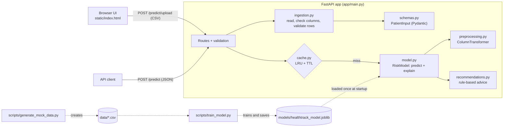

# HealthTrack: AI-Powered Patient Health Insights

> **Important:** HealthTrack is an educational demonstration. All patient data and all risk labels are
> **synthetic** (generated by a script). They do not represent real clinical outcomes, and the model is
> **not** clinically validated. It does not provide medical advice, diagnosis, or treatment.

## 1. Project Overview

HealthTrack helps a health coach get quick, explainable insights from patient health data. The coach
uploads a CSV file of patients, and for every valid patient the app returns:

- a predicted risk level: **Low**, **Medium** or **High Risk**
- the probability of each risk level
- the **top three factors** that contributed most to the prediction
- **personalised recommendations** based on the risk level, those factors, and the patient's own values

The project was built as a take-home assignment for an AI Engineer role, to show an end-to-end ML feature:
data ingestion and validation, a trained model, an API, explainability, a simple UI, tests, logging,
and caching.

**Main features**

- CSV upload with per-row validation: invalid rows are reported with row number and reason, while valid
  rows are still processed
- Multiclass Logistic Regression in a scikit-learn `Pipeline` (imputation, scaling, one-hot encoding)
- Per-patient feature contributions from the model's coefficients
- Rule-based recommendations that are easy to read and extend
- FastAPI backend with JSON and CSV endpoints and consistent error responses
- In-memory LRU cache with a time-to-live (TTL)
- Console and rotating file logging that never records patient health values
- Single-page HTML/CSS/JavaScript frontend
- 62 automated tests (pytest)

## 2. Architecture



**How a request flows**

1. The coach picks a CSV in the browser. JavaScript sends it to `POST /predict/upload` with `fetch` and
   `FormData`.
2. FastAPI checks the file type and size (max 2 MB), then `ingestion.py` reads the CSV with pandas, checks
   that all required columns exist, and validates every row with the `PatientInput` Pydantic model.
3. Invalid rows become `row_errors`. Valid patients go to `run_predictions()` in `main.py`.
4. For each patient, a cache key is built from their normalised features plus the model version. Cache hits
   are returned immediately; all misses are sent to the model together in one batch.
5. `RiskModel.predict()` runs the saved pipeline (preprocessing + Logistic Regression), returns
   probabilities, and calculates the top three contributing factors.
6. `generate_recommendations()` builds advice from the risk level, top factors and patient values.
7. The response (predictions, row errors, disclaimer) goes back to the browser, which renders a table with
   colour-coded badges and expandable details.

**Two separate workflows**

- **Offline (training):** `generate_mock_data.py` creates the dataset, and `train_model.py` trains, evaluates
  and saves the model plus `models/metrics.json`.
- **Online (serving):** the API loads the saved model **once at startup** and never retrains per request.

## 3. Tech Stack

| Technology | Purpose |
|---|---|
| Python 3.11+ | Main language (developed and tested on Python 3.13) |
| FastAPI | Web API framework: routing, automatic request validation, built-in docs at `/docs` |
| Pydantic | Defines and validates patient data (types, ranges, allowed categories) |
| pandas | Reads CSV files and handles tabular data |
| scikit-learn | Preprocessing (`SimpleImputer`, `StandardScaler`, `OneHotEncoder`, `ColumnTransformer`), `LogisticRegression`, metrics |
| joblib | Saves and loads the trained model pipeline |
| uvicorn | ASGI server that runs the FastAPI app |
| python-multipart | Lets FastAPI accept file uploads |
| python-dotenv | Loads optional settings from a local `.env` file |
| pytest + httpx2 | Automated tests; FastAPI's `TestClient` uses httpx2 to call the app in memory |
| HTML, CSS, vanilla JavaScript | The single-page frontend, with no framework or build step |

## 4. Project Structure

```
healthtrack/
├── app/
│   ├── main.py              # FastAPI app, routes, startup, error handlers, run_predictions()
│   ├── config.py            # Settings from environment variables / .env
│   ├── schemas.py           # Pydantic models: PatientInput (validation) and response formats
│   ├── ingestion.py         # CSV reading, column checks, per-row validation, row errors
│   ├── preprocessing.py     # Feature lists, ColumnTransformer, prepare_features()
│   ├── model.py             # Train, evaluate, save/load, RiskModel (predict + explain)
│   ├── recommendations.py   # Disclaimer, risk-level guidance, factor rules
│   ├── cache.py             # PredictionCache: in-memory LRU cache with TTL
│   ├── logging_config.py    # Console + rotating file logging
│   └── static/index.html    # Single-page frontend
├── scripts/
│   ├── generate_mock_data.py  # Creates the synthetic dataset and the demo upload file
│   └── train_model.py         # Trains, evaluates, saves the model and metrics
├── data/
│   ├── synthetic_patients.csv # 1,000 labelled synthetic patients (training data)
│   └── sample_patients.csv    # 18-row demo upload, including 6 deliberately invalid rows
├── models/
│   ├── healthtrack_model.joblib  # Trained pipeline (~6 KB, committed for convenience)
│   └── metrics.json              # Evaluation results from the last training run
├── logs/                    # Created at runtime; ignored by Git
├── tests/                   # pytest test suite
├── requirements.txt
├── pytest.ini
├── .env.example
└── .gitignore
```

## 5. Setup and Installation

The commands below are for **Windows PowerShell**. macOS/Linux equivalents are shown where they differ.
Run everything from the `healthtrack` folder.

```powershell
# 1. Create a virtual environment
python -m venv .venv

# 2. Activate it
.venv\Scripts\Activate.ps1          # macOS/Linux: source .venv/bin/activate
# If PowerShell blocks the script, run once:
#   Set-ExecutionPolicy -Scope CurrentUser RemoteSigned

# 3. Install dependencies
pip install -r requirements.txt

# 4. (Optional) copy the example settings; every setting has a default
copy .env.example .env               # macOS/Linux: cp .env.example .env

# 5. Generate the synthetic data (reproducible: fixed random seed)
python -m scripts.generate_mock_data

# 6. Train and evaluate the model (saves models/healthtrack_model.joblib and models/metrics.json)
python -m scripts.train_model

# 7. Start the API server
uvicorn app.main:app --reload
```

Steps 5 and 6 are optional because the generated data and trained model are already committed. Run
them to reproduce or regenerate them.

- **UI:** open <http://127.0.0.1:8000> and upload `data/sample_patients.csv`
- **Interactive API docs:** <http://127.0.0.1:8000/docs>

**Run the tests**

```powershell
pytest
```

## 6. API Documentation

All prediction responses use the same format and always include the medical disclaimer. Errors always
include a `detail` message.

### `GET /health`

```bash
curl http://127.0.0.1:8000/health
```

```json
{"status": "ok", "model_loaded": true, "model_version": "1.0.0"}
```

If the model file is missing, the server still starts, `/health` reports `"model_loaded": false`, and
the prediction endpoints return **503** with instructions to train the model.

### `POST /predict` (JSON)

Accepts 1 to 1,000 patients. Health fields may be omitted or set to `null`, in which case the model's imputer fills them in.

```bash
curl -X POST http://127.0.0.1:8000/predict \
  -H "Content-Type: application/json" \
  -d '{"patients": [{"patient_id": "P100", "age": 58, "sex": "male", "bmi": 32.1,
       "systolic_bp": 145, "diastolic_bp": 92, "resting_hr": 80, "glucose": 130,
       "cholesterol": 250, "smoker": "current", "alcohol_units_week": 10,
       "exercise_days_week": 1, "sleep_hours": 6, "family_history": "yes"}]}'
```

On Windows PowerShell, use `curl.exe` and save the JSON to a file (`-d "@patient.json"`), or try the
endpoint from <http://127.0.0.1:8000/docs>.

Response (recommendations shortened):

```json
{
  "model_version": "1.0.0",
  "total_rows": 1,
  "predictions": [
    {
      "patient_id": "P100",
      "risk_level": "high",
      "risk_label": "High Risk",
      "probabilities": {"low": 0.0, "medium": 0.0026, "high": 0.9974},
      "top_factors": [
        {"feature": "systolic_bp", "value": 145.0, "contribution": 1.1869, "direction": "increases"},
        {"feature": "glucose", "value": 130.0, "contribution": 1.1691, "direction": "increases"},
        {"feature": "smoker", "value": "current", "contribution": 1.0185, "direction": "increases"}
      ],
      "recommendations": [
        "Encourage the patient to arrange a review with a qualified healthcare professional soon.",
        "Agree on a structured plan with regular follow-ups to track progress.",
        "Blood pressure is elevated: recommend discussing blood pressure monitoring with a qualified healthcare professional.",
        "Suggest seeking professional smoking cessation support."
      ],
      "cached": false
    }
  ],
  "row_errors": [],
  "disclaimer": "This application is an educational demonstration and does not provide medical advice, diagnosis, or treatment. Consult a qualified healthcare professional for medical decisions."
}
```

Validation error (**422**). The submitted values are not echoed back:

```json
{"detail": "Invalid request data.",
 "errors": [{"location": "body.patients.0.age", "message": "Input should be less than or equal to 110"}]}
```

### `POST /predict/upload` (CSV)

```bash
curl -F "file=@data/sample_patients.csv;type=text/csv" http://127.0.0.1:8000/predict/upload
```

The response uses the same format as `/predict`. With the sample file, 12 rows are predicted, and 6 appear
in `row_errors`. `row_number` is the line in the CSV file (the header is line 1):

```json
"row_errors": [
  {"row_number": 14, "patient_id": "BAD001", "reason": "age: Input should be less than or equal to 110"},
  {"row_number": 15, "patient_id": "BAD002", "reason": "sex: Input should be 'male' or 'female'"},
  {"row_number": 16, "patient_id": "BAD003", "reason": "bmi: Input should be a valid number, unable to parse string as a number"},
  {"row_number": 17, "patient_id": "BAD004", "reason": "diastolic_bp must be lower than systolic_bp"},
  {"row_number": 18, "patient_id": null, "reason": "patient_id: Field required"},
  {"row_number": 19, "patient_id": "S001", "reason": "Duplicate patient_id; only the first occurrence is used."}
]
```

**Required CSV columns:** `patient_id, age, sex, bmi, systolic_bp, diastolic_bp, resting_hr, glucose,
cholesterol, smoker, alcohol_units_week, exercise_days_week, sleep_hours, family_history`. Extra columns
are ignored, and column names and category values are case-insensitive.

**Allowed values**

| Field | Valid range / values |
|---|---|
| age | 18–110 (whole number) |
| sex | male, female |
| bmi | 10–80 |
| systolic_bp / diastolic_bp | 70–250 / 40–150, diastolic must be lower than systolic |
| resting_hr | 30–220 |
| glucose | 40–500 |
| cholesterol | 80–500 |
| smoker | never, former, current |
| alcohol_units_week | 0–150 |
| exercise_days_week | 0–7 (whole number) |
| sleep_hours | 0–24 |
| family_history | yes, no |

These bounds reject impossible or implausible data. They are not clinical reference ranges.

### Status codes

| Status | When |
|---|---|
| 200 | Success, including partial CSV success (some rows in `row_errors`) |
| 400 | Not a CSV, not UTF-8, unparseable, empty, or missing required columns |
| 413 | Upload larger than 2 MB |
| 422 | Invalid JSON body or patient field values |
| 503 | Model file not loaded |
| 500 | Unexpected error (generic message only; details go to the server log) |

## 7. Model Details

### Dataset generation (`scripts/generate_mock_data.py`)

- 1,000 synthetic patients, generated with fixed seed `42`, so every run produces the same data.
- Values are drawn from plausible distributions, with a few simple relationships (for example, blood
  pressure and cholesterol rise with age, and glucose rises with BMI).
- **Labels come from a transparent points rule** (`calculate_risk_points`). Examples: age ≥ 60 (+2),
  BMI ≥ 30 (+2), systolic BP ≥ 140 (+2), current smoker (+2), exercising 5 or more days a week (−1).
  Gaussian noise (σ = 1) is added, and the total is converted to a label: under 3.5 points is `low`,
  6 or more is `high`, and anything in between is `medium`. The noise means the problem is not perfectly
  deterministic, just as real data is never perfectly clean.
- About 2% of values in five columns are blanked out after labelling, so missing-value handling gets used
  during training.
- Class distribution: **low 378, medium 376, high 246**.

### Preprocessing (`app/preprocessing.py`)

A `ColumnTransformer` inside the model `Pipeline`:

- **Numeric features:** `SimpleImputer(strategy="median")`, then `StandardScaler`. The median is robust to
  outliers, and scaling puts features on a similar range so Logistic Regression trains well and its
  coefficients can be compared.
- **Categorical features:** `SimpleImputer(strategy="most_frequent")`, then
  `OneHotEncoder(handle_unknown="ignore")`. An unseen category becomes all zeros instead of an error.

Because preprocessing is part of the pipeline, the same fitted transformations are applied at training
and prediction time. The pipeline is fitted **only on the training split**, so the median, mean and
standard deviation never include test data, which avoids data leakage.

### Training and evaluation (`scripts/train_model.py`)

- 80/20 `train_test_split`, **stratified** by risk level, with seed `42`
- `LogisticRegression(max_iter=1000)`. With three classes, scikit-learn fits a multinomial model.
- Metrics on the 200-patient held-out test set (saved to `models/metrics.json`):

| Metric | Value |
|---|---|
| Accuracy | **0.690** |
| Baseline (always predict the most common class) | 0.380 |

| Class | Precision | Recall | Test support |
|---|---|---|---|
| low | 0.779 | 0.789 | 76 |
| medium | 0.580 | 0.627 | 75 |
| high | 0.738 | 0.633 | 49 |

Confusion matrix (rows = true, columns = predicted):

| | low | medium | high |
|---|---|---|---|
| **low** | 60 | 16 | 0 |
| **medium** | 17 | 47 | 11 |
| **high** | 0 | 18 | 31 |

**What these mean:** *accuracy* is the share of all predictions that were correct. *Precision* for a
class asks: of the patients predicted as that class, how many really were that class? *Recall* asks: of
the patients who really were that class, how many did the model find? The confusion matrix shows the
model never confuses low with high. Its mistakes are between neighbouring levels, and *medium* is the
hardest class because it sits between the other two.

**Honest limitations:** these numbers only show how well the model re-learns *our own synthetic labelling
rule*, plus noise. They are **not** evidence of real-world medical performance. The roughly 69% ceiling
comes mostly from the noise we deliberately added. The test set is also small (200 patients), so the
numbers would shift a few points with a different split.

### Feature contributions (`RiskModel.explain` in `app/model.py`)

For Logistic Regression, the score for a class is `intercept + Σ (coefficient × feature value)`. For each
patient we:

1. Transform their features with the fitted preprocessor (scaled numbers and one-hot columns).
2. Multiply each transformed value by the **coefficient for the predicted class**.
3. Add the one-hot columns of each categorical feature back together, so `smoker` appears as one factor.
4. Sort the results and return the three largest, with `direction` set to `"increases"` (pushes the
   predicted class's score up) or `"decreases"`, plus the patient's original `value`.

Because numeric features are standardised, a value of 0 means an average training patient. So a
contribution describes how this patient's difference from average moved the score. Directions are
relative to the **predicted** class. For a Low Risk patient, a low glucose value "increases" the Low Risk
score.

> These are **approximate model contributions, not causal explanations or medical conclusions**. They
> describe what the model's linear formula responded to, not why a person's risk is what it is. When
> features are correlated (for example, age and blood pressure), the credit can be split between them in
> ways that are not intuitive.

## 8. Design Decisions and Trade-offs

**Logistic Regression instead of Random Forest.** The synthetic labels come from an additive points
rule, and that is what a linear model is designed to learn. Its coefficients also give simple, exact
per-patient contributions without extra libraries like SHAP. It trains in milliseconds, the saved file is
about 6 KB, and its probabilities are reasonably well calibrated. A Random Forest could capture
interactions, but it is harder to explain, and on this data it would add complexity without a clear
benefit. The trade-off is that a linear model cannot learn interactions such as "smoking matters more
with age" unless those features are created by hand.

**Rule-based recommendations instead of relying on an LLM.** Rules are deterministic, testable, free,
fast, and work offline. They can never invent medical claims, and every message can be reviewed in one
file (`FACTOR_RULES`). The trade-off is that they are less natural and less personalised than generated
text. The optional LLM integration was **not implemented**, so the app needs no API key and sends no
patient data to external services.

**In-memory caching.** A small `OrderedDict` with LRU eviction and a TTL is enough for one server process
and is easy to explain. The key is a SHA-256 hash of the normalised features plus the model version, so a
retrained model never serves old results. The `patient_id` is not part of the key because predictions
depend only on features. **Limitation:** each process has its own cache, and the cache is cleared on
restart. A multi-instance production deployment would need a shared cache such as Redis.

**Synthetic data.** Real patient data is sensitive and regulated. Synthetic data lets the whole pipeline
be built, tested and shared safely. It also has a known "true" rule, which makes it easy to check that
the model behaves sensibly. The trade-off is that nothing it learns applies to real patients.

**FastAPI.** It validates requests with Pydantic automatically, generates interactive docs at `/docs`, is
fast, and is the standard choice for serving Python ML models. One Pydantic model (`PatientInput`)
validates both JSON requests and every CSV row, so both paths follow exactly the same rules.

**Synchronous (`def`) endpoints.** The work is CPU-bound pandas and scikit-learn code. FastAPI runs `def`
endpoints in a thread pool, so they don't block the event loop, and the code stays simpler than `async`.

**Partial CSV success.** One bad row should not stop a coach from getting results for the other 99.
Problems that affect the whole file (wrong format, missing columns) return 400. Problems in a single row
are listed in `row_errors` with a 200 response. Duplicate patient IDs are also reported, and the first
occurrence is kept.

**Current limitations**

- The data and labels are synthetic, and the model has no clinical validity.
- The JSON endpoint is all-or-nothing: one invalid patient returns 422 for the whole request.
- A CSV with broken structure (for example, a row with too many fields) is rejected as a whole, not row by row.
- Contributions are linear approximations, not causal explanations.
- There is no authentication, persistence, or audit trail (out of scope for this assignment).
- The cache and the model are per process.

## 9. Security Considerations

- **Input validation:** every patient is validated by Pydantic. This covers types, numeric ranges that
  reject impossible values, allowed category values, a diastolic/systolic sanity check, and NaN/infinity
  rejection. `patient_id` is restricted to letters, digits, `_` and `-`, which keeps it safe to display and
  log. JSON requests are limited to 1,000 patients.
- **Upload limits:** files must have a `.csv` extension and a CSV-like content type. The server reads at
  most 2 MB + 1 byte and returns 413 if the file is bigger. The content must decode as UTF-8 and parse as
  CSV.
- **No user-supplied models:** joblib/pickle files can run code when loaded, so the app only loads the
  model from its own configured path (`MODEL_PATH`) and never from an upload.
- **Secrets:** nothing is hard-coded. Settings come from environment variables or a local `.env` file,
  which is git-ignored. Only `.env.example` is committed. The app currently needs no secrets at all.
- **Safe logging:** logs contain counts, timings, row numbers, cache-key prefixes, and error types, never
  complete patient records or health values. The 422 handler does not echo submitted values.
- **No stack traces to users:** a global exception handler logs the full error on the server and returns
  a generic 500 message.
- **Frontend XSS protection:** the UI inserts all server data with `textContent`, never `innerHTML`, so
  values from a CSV can never run as HTML or script.
- **Not covered (out of scope):** authentication, rate limiting, HTTPS, and data encryption at rest.
  These would be required before handling any real patient data.

## 10. Testing

```powershell
pytest            # run everything (about 2 seconds)
pytest -v         # list each test
pytest tests/test_api.py
```

The tests train their own small model in memory (`tests/conftest.py`), so they don't depend on the files
in `models/`.

| File | What it covers |
|---|---|
| `test_ingestion.py` | Valid CSV, name/category normalisation, missing columns, empty/binary files, header-only files, each invalid-value type, partial success with correct row numbers, duplicates, blanks kept for imputation, extra columns |
| `test_preprocessing.py` | Scaling (mean 0, std 1), median and most-frequent imputation, one-hot encoding, unknown categories, consistent transforms, column order |
| `test_model.py` | All three classes, predictions, probabilities sum to 1, top factors ranked and well-formed, clear high/low profiles, save and load round trip, evaluation metrics |
| `test_recommendations.py` | Low/medium/high guidance, attribute-based rules, factor ordering, rules that only fire for concerning values, no duplicate messages, missing values, disclaimer |
| `test_cache.py` | Miss, hit, copy safety, TTL expiry (with a fake clock), model-version invalidation, key normalisation, LRU eviction at max size |
| `test_api.py` | Health, UI served, JSON success, cache hit on repeat, 422 validation, CSV success, partial success, all-invalid, 400 invalid file / wrong type / missing columns, 413 oversized, 503 missing model, safe 500 |

## 11. Future Improvements

- **Data:** use real, ethically sourced, consented, and clinically validated data, with clinicians defining
  the risk outcomes.
- **Evaluation:** use cross-validation with confidence intervals, calibration curves, per-subgroup
  fairness checks (for example by sex and age band), and a separate validation set for tuning.
- **Modelling:** tune regularisation, compare gradient boosting, and add interaction features.
- **Explainability:** use SHAP values relative to a clear baseline, and show plain-language factor
  explanations in the UI.
- **Recommendations:** have clinicians review the rules. An optional LLM could rephrase the rule output,
  but it should only receive de-identified features and fall back to rules on failure.
- **Security:** add authentication, role-based access control, rate limiting, HTTPS, and audit logs.
- **Persistence:** store uploads and predictions in a database, and keep model versions in a registry.
- **Scaling:** use a distributed cache (Redis), and run several API workers behind a load balancer.
- **Monitoring:** add structured logs, metrics (latency, error rates, prediction distribution), and data
  drift alerts.
- **UI:** add sorting and filtering, CSV export of results, and accessibility testing.

## 12. AI Usage

> **Draft: to be completed by the author.** Edit each placeholder so it accurately describes your own work.

**Tools used**

- **Claude (claude.ai):** used for project planning, including breaking down the requirements and drafting
  the specification prompt.
- **Claude Code in VS Code:** used for implementation assistance, including generating code, tests and
  documentation drafts from my specification.

**What I personally did**

- *Reviewed:* `[TODO: which files and design decisions you reviewed line by line]`
- *Modified:* `[TODO: what you changed from the AI-generated output, and why]`
- *Tested:* `[TODO: what you ran yourself, e.g. pytest, manual UI upload, curl requests, edge cases you tried]`
- *Understood and can explain:* `[TODO: e.g. the request flow, preprocessing, coefficient-based contributions, caching]`
- *Decisions I made:* `[TODO: e.g. choosing Logistic Regression, not implementing the LLM integration]`

**How I verified AI output:** `[TODO: e.g. ran the test suite, checked metrics, read the scikit-learn docs for ...]`
